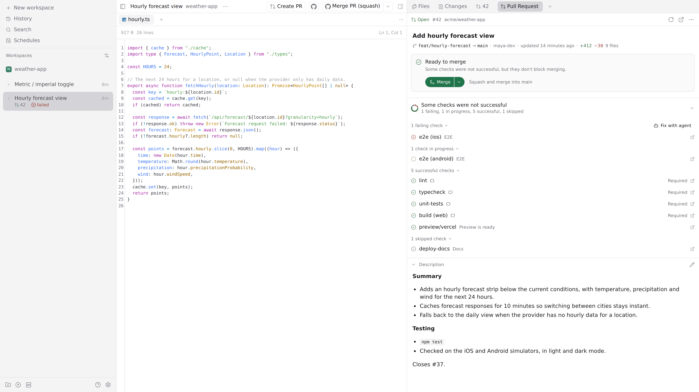
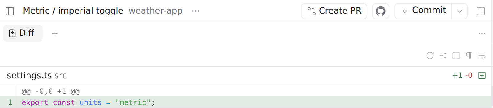
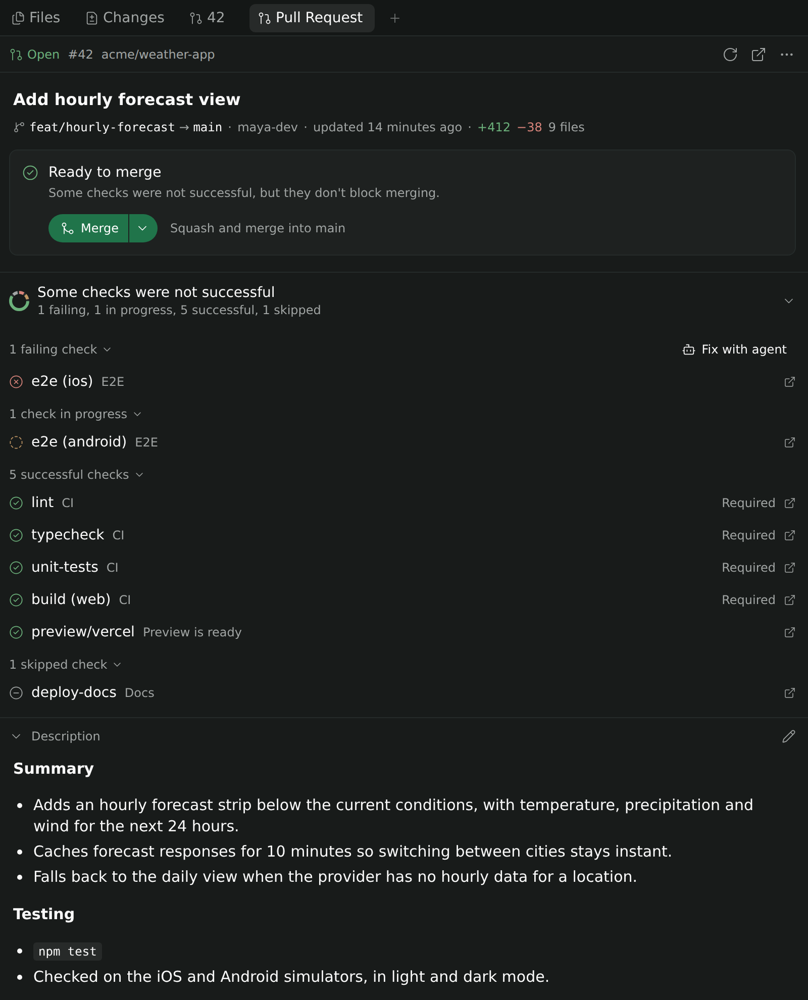

# Paseo Pull Request

A [Paseo](https://paseo.sh) plugin that keeps the pull request loop inside your workspace: open a PR in one click, read it, watch CI, merge it, and hand conflicts or failing checks to an agent.

It works with GitHub and GitHub Enterprise through the `gh` CLI on the daemon host.



## Install

You need:

- Paseo 0.13 or later.
- The [GitHub CLI](https://cli.github.com) installed and signed in (`gh auth login`) on the machine that runs the Paseo daemon.
- A workspace in a Git repository with a GitHub remote. The plugin uses `origin` when present.

Then run:

```sh
paseo plugin install git:kslr/paseo-pull-request
```

Open a Git workspace and pick **Pull Request** in the Explorer, or run **Open pull request** from the Command Center.

To update later, run `paseo plugin update paseo-pull-request`. To remove it, run `paseo plugin remove paseo-pull-request`.

## Create PR



The **Create PR** button sits in the workspace header (desktop) and takes you from local changes to an open pull request in one press:

- It commits uncommitted changes, pushes the branch and creates the PR, then opens the Pull Request panel.
- On the default branch, it first creates a feature branch, carrying your changes, and switches the workspace to it, so later commits from you or your agents land on the PR. When the local default branch is only behind its remote, the new branch starts from the freshly fetched remote tip.
- When the branch already has an open PR, it opens the panel instead.
- When there is nothing to do (no changes, a diverged branch, a merged PR with no new commits…), the button says why on hover and when pressed.

The commit message, branch name, PR title and description are written by the model chosen in Paseo's metadata generation settings, and follow the project's `paseo.json` `metadataGeneration` instructions. Each press uses that model, so it counts toward its usage. With Claude this is a one-shot `claude -p`; other providers run a short-lived read-only agent in the workspace, archived afterwards.

## Pull Request panel



The panel lives in the workspace's Explorer and shows the pull request of the current branch:

- **Toolbar**: the state, number and repository, plus refresh, open on GitHub, and a menu with Copy link, Edit title, Convert to draft, Close / Reopen and Delete branch.
- **Title and meta line**: `head → base`, author, last update, lines changed and files.
- **Merge card** for open PRs, saying whether the PR can merge and, if not, why:
  - **Merge** is a split button: the left half merges, the right half picks merge, squash or rebase.
  - **Enable auto-merge** appears when branch protection blocks merging and the repository allows auto-merge.
  - **Ready for review** appears on drafts.
  - **Fix with agent** appears on conflicts. It starts an agent in the workspace, set up like your most recent agent, to bring the branch up to date and resolve them.
- **Checks**: a summary ring and a collapsible list grouped into failing, in progress, successful and skipped. Duplicate runs fold into one row and required checks are marked. When checks fail, **Fix with agent** hands them to an agent. Pending checks refresh every 10 seconds.
- **Description**, rendered as Markdown and editable in place.

The panel follows your Paseo theme and works on desktop, web, iOS and Android.

Comments, reviews, diffs, labels and reviewers stay on GitHub; Paseo's built-in Pull request panel shows the activity timeline.

<br clear="right">

## Good to know

- Everything the plugin does on GitHub runs as the account `gh` is signed in with on the daemon host, with that account's permissions. Buttons you are not allowed to use are hidden.
- If the panel shows **GitHub CLI not found** or **Sign in to GitHub**, install `gh` or run `gh auth login` on the daemon host, not on the device you are using. **No GitHub remote** means the repository has no remote pointing at GitHub.
- Plugin output, including errors, is in `paseo plugin logs paseo-pull-request`.

## Development

```sh
npm install
npm run typecheck
npm test

paseo plugin install /path/to/paseo-pull-request
paseo plugin reload paseo-pull-request
paseo plugin logs paseo-pull-request
```

There is no build step: Paseo compiles `index.client.tsx` and `index.server.ts` itself. After installing from a local directory, run `paseo plugin reload` to pick up changes.

The code is organized by feature, with matching client, server and contract files:

- **Pull Request panel**: `shared/pullRequest.ts` (RPC contract), `server/pullRequest/` (finding, reading and updating PRs), `client/panel/` (the panel).
- **Create PR button**: `shared/createPullRequest.ts`, `server/createPullRequest/` (status, the commit → push → PR run, text generation), `client/createPullRequest/` (the header button).
- **Shared**: `server/github.ts` (GitHub remotes and `gh`), `server/process.ts` (running commands and redacting output), `client/ui.tsx` (UI building blocks).

The screenshots show a fictional repository.

## Acknowledgements

The pull request features are inspired by [T3 Code](https://github.com/pingdotgg/t3code). The server's GitHub queries, the commit → push → PR flow and the Create PR button's rules are adapted from it; see [THIRD_PARTY_NOTICES.md](THIRD_PARTY_NOTICES.md).

## License

[GPL-3.0](LICENSE)
